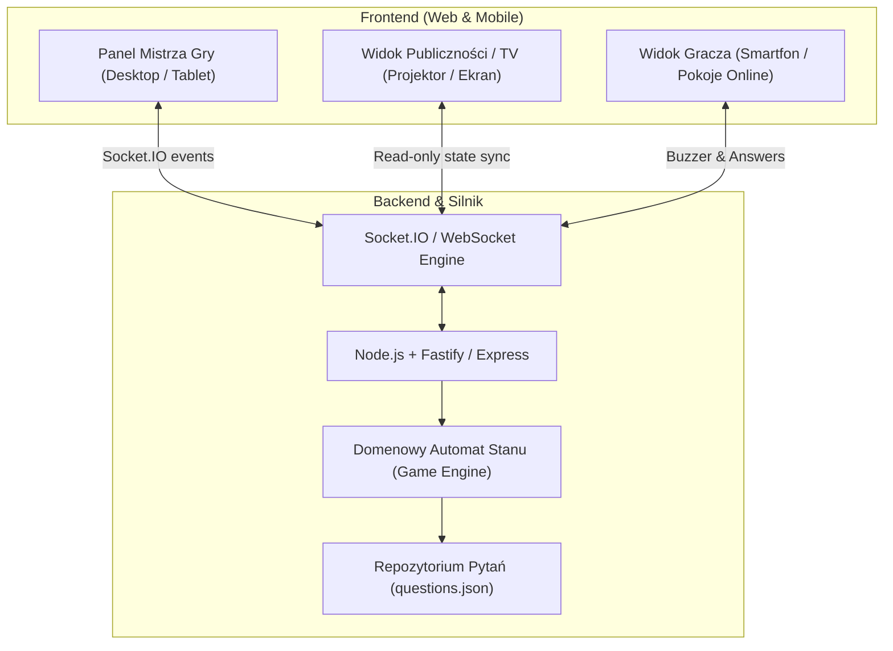
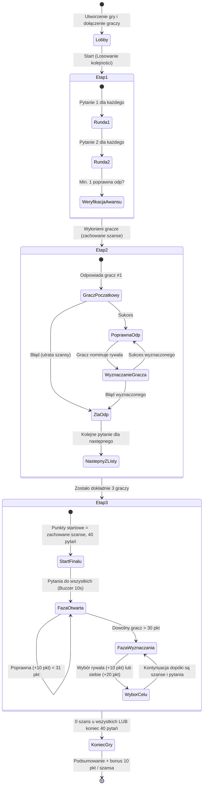

# Plan Projektu: JZD (Jeden z Dziesięciu)

Kompleksowy projekt nowoczesnej platformy do gry quizowej wzorowanej na teleturnieju *Jeden z dziesięciu*, zoptymalizowanej pod rozgrywki 4–15 graczy, z bazą ponad 5000 pytań oraz dwoma trybami: **Towarzyskim (Mistrz Gry / TV)** i **Interaktywnym (Pokoje Online)**.

---

## 1. Architektura i Rekomendowany Stos Technologiczny

Dla gry czasu rzeczywistego (wymagającej natychmiastowego buzzera 10s, synchronizacji liczników 30s i stanu szans/punktów), rekomendujemy architekturę opartą o **TypeScript monorepo / split client-server**:

### Rekomendowane Technologie:
- **Backend**: **Node.js + TypeScript + Fastify + Socket.IO**
  - *Dlaczego*: Ekstremalnie niski narzut (low latency) kluczowy przy wirtualnym buzzerze (kto pierwszy kliknie w ułamku sekundy), stabilne pokoje (rooms/namespaces), weryfikacja czasu po stronie serwera (zabezpieczenie przed manipulacją czasem w przeglądarce).
- **Frontend**: **React 19 + Vite + TypeScript + Tailwind CSS**
  - *Dlaczego*: Błyskawiczny start, doskonała responsywność (widok gracza na telefonie, widok prowadzącego na laptopie), bogaty ekosystem komponentów.
- **Dźwięk i Animacje**: **Howler.js + Lucide Icons + Framer Motion**
  - *Dlaczego*: Klasyczne dźwięki teleturnieju (odliczanie sekundnika, gong poprawnej odpowiedzi, syrena błędu, utrata szansy) budują 80% klimatu rozgrywki.
- **Baza Danych Pytań**:
  - `data/questions.json` (**11 052 pytań** po oczyszczeniu i połączeniu bazy klasycznej 5067 pytań oraz zbioru PolEval 2021 Q&A z 5985 pytaniami w stylu 1z10). Posiada podział na kategorie, znormalizowaną interpunkcję oraz tablicę alternatywnych dopuszczalnych odpowiedzi (`aliases`).

---

## 2. Model Domenowy i Mechanika Rozgrywki (Automaty Stanów)

### Parametry Ogólne
- **Liczba graczy**: 4 do 15 (domyślnie 10).
- **Czas na odpowiedź**: 30 sekund (zegar serwerowy).
- **Czas na zgłoszenie (finał buzzer)**: 10 sekund.
- **Pula pytań**: unikalne pytania losowane bez powtórzeń w trakcie jednej gry.

---

## 3. Szczegółowe Reguły i Przepływy

### Etap 1: Eliminacje
1. Kolejność graczy jest losowana. Każdy otrzymuje **3 szanse**.
2. Rozgrywane są dokładnie 2 kolejki pytań:
   - Każdy gracz otrzymuje najpierw jedno pytanie, potem w drugiej kolejce drugie pytanie.
   - Błędna odpowiedź lub upływ 30s = utrata 1 szansy.
3. Warunek przejścia: **gracz musi odpowiedzieć poprawnie na co najmniej 1 pytanie** (czyli mieć co najmniej 1 szansę oraz min. 1 trafioną odpowiedź).
4. Gracze, którzy nie odpowiedzieli na żadne pytanie (2 błędy), odpadają.

### Etap 2: Wskazywanie
1. Uczestnicy zachowują szanse z Etapu 1 (od 1 do 3).
2. Pytanie 1 otrzymuje gracz #1 z listy.
   - Jeśli odpowie poprawnie: uzyskuje prawo wyznaczenia dowolnego innego uczestnika z puli aktywnych.
   - Jeśli odpowie błędnie: traci szansę, a nowe pytanie otrzymuje kolejny gracz wg listy. Sytuacja powtarza się, dopóki ktoś nie odpowie poprawnie.
3. Po poprawnej odpowiedzi gracz wyznacza rywala:
   - Jeśli wyznaczony odpowie poprawnie: to on przejmuje prawo wyznaczania!
   - Jeśli wyznaczony odpowie błędnie: traci szansę. (Prawo wyznaczania wraca do poprzednika lub wg reguły teleturnieju).
4. Gracz traci ostatnią szansę $\rightarrow$ odpada.
5. Etap kończy się w momencie, gdy przy życiu zostanie **dokładnie 3 graczy**.

### Etap 3: Wielki Finał
1. Start: 3 graczy otrzymuje punkty początkowe równe liczbie ocalałych szans (np. 3 szanse = 3 punkty). Pula finałowa wynosi 40 pytań.
2. **Część 1 (Pytania otwarte dla wszystkich)**:
   - Prowadzący / system wyświetla pytanie.
   - Odliczanie 10 sekund na zgłoszenie (Buzzer).
   - Kto pierwszy się zgłosi, ma 30s na wpisanie odpowiedzi (tryb online) lub odpowiedź ustną (tryb towarzyski).
   - **Poprawna odpowiedź**: **+10 punktów**.
   - **Błędna odpowiedź**: utrata **1 szansy**.
   - Ta część trwa do momentu, gdy którykolwiek z graczy **przekroczy 30 punktów** ($>30$).
3. **Część 2 (Wyznaczanie)**:
   - Gracz mający głos decyduje:
     - **Wyznacza siebie ("biorę na siebie")**:
       - Poprawna odpowiedź: **+20 punktów** i gracz nadal wyznacza.
       - Błędna odpowiedź: gracz traci **1 szansę**, a gra **wraca do pytań ogólnych dla wszystkich (Buzzer)**.
     - **Wyznacza przeciwnika**:
       - Przeciwnik odpowiada poprawnie: otrzymuje **+10 punktów** i przejmuje prawo wyznaczania.
       - Przeciwnik odpowiada błędnie: traci **1 szansę**, a **prawo wyznaczania wraca do gracza, który go wyznaczył**.
4. **Warunek Końca Finału**:
   - Wszyscy gracze stracą szanse LUB wyczerpie się 40 pytań.
   - Przy wyczerpaniu pytań: doliczany jest **bonus +10 punktów za każdą zachowaną szansę**.
   - Zwycięża gracz z najwyższym wynikiem punktowym.

---

## 4. Tryby Rozgrywki i Interfejsy

| Funkcjonalność | Tryb Towarzyski (Domowy / Imprezowy) | Tryb Interaktywny (Pokoje Online) |
| :--- | :--- | :--- |
| **Główny Użytkownik** | Mistrz Gry (laptop / tablet) | Mistrz Gry + Zdalni Gracze na telefonach |
| **Wprowadzanie Graczy** | Mistrz Gry wpisuje listę imion (4-15) | Gracze dołączają przez link / kod PIN pokoju |
| **Zadawanie Pytań** | MG czyta na głos z ekranu | Treść pytania pojawia się na ekranach graczy |
| **Odpowiedzi** | Gracze odpowiadają ustnie, MG klika Poprawna/Błędna | Gracze wpisują tekst w polu na telefonie (limit 30s) |
| **Timer / Odliczanie** | **Aktywny zegar 30s w panelu MG** (odliczanie, dźwięk tykania, alert 5s, auto „Czas minął”) | Serwerowy zegar 30s zsynchronizowany na ekranach graczy i MG |
| **Weryfikacja Odpowiedzi**| W rękach MG (widzi sugerowaną odpowiedź) | MG widzi wpisany tekst gracza vs wzorzec i zatwierdza |
| **Zgłaszanie w Finale** | Ustne / dzwonek fizyczny / kliknięcie przez MG | **Wirtualny Buzzer (10s)** na telefonie (kto pierwszy kliknie) |
| **Drugi Ekran (TV)** | Opcjonalny widok teleturniejowy dla graczy/widzów | Tablica wyników na żywo na ekranie MG / TV |

---

## 5. Etapy Realizacji Projektu (Roadmap)

### Faza 1: Silnik Logiki i Parser Pytań
- [x] Walidacja i oczyszczenie `data/questions.json` (11 052 unikalnych pytań: połączenie bazy klasycznej 5067 pytań + zbioru PolEval 2021 z 5985 pytaniami, normalizacja spacji i interpunkcji, tablica synonimów `aliases`).
- [ ] Implementacja niezależnej maszyny stanów `GameEngine` w TypeScript z pełnymi testami jednostkowymi (Vitest/Jest).
- [ ] Obsługa przejść: Etap 1 $\rightarrow$ Etap 2 $\rightarrow$ Finał, losowanie bez powtórzeń, przeliczanie punktów.

### Faza 2: Serwer i Komunikacja Czasu Rzeczywistego
- [ ] Serwer Fastify/Express z Socket.IO.
- [ ] Pokoje gier (zarządzanie pokojami, generowanie kodów PIN, reconnect gracza).
- [ ] Serwerowe timery (30s na odpowiedź, 10s na buzzer) z synchronizacją co 100ms.

### Faza 3: Tryb Towarzyski (Asystent Mistrza Gry + Ekran TV)
- [ ] Pulpit Mistrza Gry:
  - Podgląd pytania i ukrytej/jawnej odpowiedzi.
  - **Interaktywny zegar 30s**: automatyczny start przy pytaniu, pauza, reset, animowany pasek czasu, dźwięk ostrzegawczy przy 5s i gong końca czasu.
  - Przyciski werdyktu: *Poprawna*, *Błędna*, *Czas minął*.
  - Sterowanie etapem, ręczna korekta szans/punktów (w razie pomyłki MG).
- [ ] Dedykowany widok TV/Rzutnik (`/tv/:gameId`):
  - Wizualizacja teleturniejowa: stanowiska graczy, podświetlanie aktywnego gracza, znikające szanse, duży zegar.

### Faza 4: Tryb Interaktywny (Klient Gracza)
- [ ] Responsywny widok gracza na smartfon:
  - Duży, responsywny Buzzer w finale (minimalny input lag).
  - Pole wpisywania odpowiedzi z licznikiem czasu 30s.
  - Wybór gracza do wyznaczenia (lista ocalałych rywali + przycisk "Biorę na siebie").
- [ ] Panel akceptacji odpowiedzi dla Mistrza Gry (porównanie tekstu gracza z bazą, zatwierdzenie jednym kliknięciem).

### Faza 5: Efekty Audiowizualne, Opcje i Szlify
- [ ] Efekty dźwiękowe (synteza / pliki audio: tykanie, gong, buzzer, werbel finałowy).
- [ ] Konfiguracja gry: zmiana liczby pytań w finale, zmiana limitów czasu (np. 20s zamiast 30s).
- [ ] Eksport wyników / statystyki gry.
